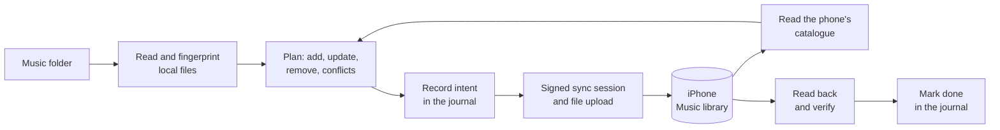

<h1 align="center">rustunes</h1>

<p align="center"><em>Demo video coming soon</em></p>

<p align="center">
  Sync your music to the stock iPhone Music app from Linux, over USB or Wi-Fi.<br>
  No iTunes, no Finder, no Windows, no jailbreak.
</p>

<p align="center">
  <a href="#requirements">Requirements</a> ·
  <a href="#installation">Installation</a> ·
  <a href="#getting-started">Getting started</a> ·
  <a href="#everyday-use">Everyday use</a> ·
  <a href="#advanced-usage">Advanced usage</a> ·
  <a href="#limitations">Limitations</a> ·
  <a href="docs/README.md">Documentation</a>
</p>

---

## About

The Music app on an iPhone only plays what Apple's own sync software put there:
Finder on a Mac, or the Apple Devices app on Windows. Linux has neither.

**rustunes** fills that gap. Point it at a folder of music and it puts the
tracks into the phone's own Music library, the same library Finder fills, with
their tags, sort names, gapless timing and cover art. It is an independent
re-implementation of Apple's sync protocol, worked out by reverse engineering
and written in Rust.

- **`sync`** mirrors your music folder: new files are sent, retagged files are
  updated in place, and tracks whose file you deleted are removed (after asking).
- **`push`** sends a folder or a single file and never removes anything.
- **`pull`** adopts a library another computer filled, so rustunes can manage it.

Every change is read back from the phone and verified before it counts as done.
If a run is interrupted, run the same command again and it picks up safely.

Development was heavily AI-assisted: AI coding agents were used throughout,
from the protocol analysis to the code.

### Features

- **Lossless and lossy formats:** ALAC, AAC (LC, HE, HE v2, xHE), MP3, FLAC,
  WAV and AIFF. FLAC can optionally be converted to ALAC on the way.
- **Full metadata:** title, artist, album, album artist, genre, composer, year,
  track and disc numbers, compilation, copyright, comment and all five sort
  names, plus the gapless timing Apple's sync computes for MP3 and AAC.
- **Cover art:** one embedded cover per track. PNG, GIF, BMP and TIFF covers are
  sent as JPEG, the only kind the phone keeps.
- **Verified:** uploaded audio, catalogue entries and covers are read back and
  compared. Tracks it did not touch are checked too: their audio, play counts,
  ratings and playlists must survive.
- **Safe to interrupt:** every write is journaled first. Kill a run, pull the
  cable or lose Wi-Fi, then run the same command again.
- **Leaves the rest alone:** it only changes tracks it sent or adopted, and it
  never modifies your music files.
- **USB or Wi-Fi:** the same commands work over both. Over Wi-Fi the phone can
  stay locked in your pocket.
- **Fast repeat runs:** a 399-track library with nothing to do syncs in under
  20 seconds.
- **Scriptable:** `--message-format json` turns any command's output into a
  stream of JSON records.
- **Reusable protocol crate:** the protocol, transfer and verification code is a
  separate library, [`music-protocol`](crates/music-protocol).

## Requirements

### To run rustunes

| What | Required? | Why |
| --- | --- | --- |
| **Linux** (x86_64 tested) | Required | rustunes is Linux-only. |
| **An iPhone** paired with and trusting this computer | Required | See [Supported phones](#supported-phones) and [Getting started](#getting-started). |
| **usbmuxd** | Required | Talks to the phone over USB, and saves the pairing record that Wi-Fi uses too. Most distributions start it automatically when an iPhone is plugged in. |
| **FFmpeg** on `PATH` | Required to send covers | Verifies covers on the phone. Also used by `--flac-to-alac` and `validate --decode`. Without it, a sync that has covers to send stops before sending anything. |
| **libimobiledevice tools** (`idevicepair`) | Optional | Only needed if the phone never shows the **Trust** prompt. |
| **The phone and computer on the same network** | For Wi-Fi only | The phone is found by Bonjour (mDNS). If your network or firewall blocks it, give the phone's address with `--wifi-address`. |

Install them with your package manager:

```bash
# Fedora
sudo dnf install usbmuxd ffmpeg-free libimobiledevice-utils

# Debian / Ubuntu
sudo apt install usbmuxd ffmpeg libimobiledevice-utils

# Arch Linux
sudo pacman -S usbmuxd ffmpeg libimobiledevice
```

### To build rustunes

| What | Version | How to get it |
| --- | --- | --- |
| **Rust** and Cargo | 1.89 or newer (developed with 1.93) | [rustup.rs](https://rustup.rs). Distribution packages are often too old. |
| **A C compiler** | Any recent GCC or Clang | Fedora: `sudo dnf install gcc` · Debian/Ubuntu: `sudo apt install build-essential` · Arch: `sudo pacman -S base-devel` |
| **Git** | Any | Your package manager |

No other system libraries are needed: SQLite is bundled and there is no
OpenSSL dependency.

### Supported phones

| | |
| --- | --- |
| Tested phone | iPhone 16 Pro Max (`iPhone17,2`), iOS 27.0.1 and 27.2 |
| Tested computer | Linux x86_64 (Fedora 44) |
| Tested library | 419 tracks, 8.6 GB, 418 covers, over USB and Wi-Fi |

Other models and iOS versions have not been tested, and Apple can change the
protocol in any iOS update. As a safeguard, rustunes reads the phone's music
database before sending anything. It refuses a database older than schema
version 2400060, or one missing a table or column it relies on. A newer version
that has everything is used, with a warning that it is untested.

## Installation

### From source

```bash
git clone https://github.com/fbiba/rustunes.git
cd rustunes
cargo build --release --locked
install -Dm755 target/release/rustunes ~/.local/bin/rustunes
```

Make sure `~/.local/bin` is on your `PATH`, then check it works:

```bash
rustunes --version
```

Alternatively, let Cargo build and install it into `~/.cargo/bin` in one step:

```bash
cargo install --locked --git https://github.com/fbiba/rustunes.git rustunes
# or, from a clone:
cargo install --locked --path crates/rustunes
```

### From crates.io

Cargo builds rustunes and installs it into `~/.cargo/bin`:

```bash
cargo install --locked rustunes
```

### Shell completion (optional)

```bash
# Current shell only
source <(rustunes completions bash)

# Permanently
mkdir -p ~/.local/share/bash-completion/completions
rustunes completions bash > ~/.local/share/bash-completion/completions/rustunes
```

### Upgrading

Install the new version over the old binary, using any method above. The first
`sync`, `push` or `pull` carries rustunes' records of what is on the phone
forward, even when the new version stores them differently.

### Uninstalling

Delete the binary (`~/.local/bin/rustunes` or `~/.cargo/bin/rustunes`). To
also remove rustunes' settings and records, delete `~/.config/rustunes` and
`~/.local/state/rustunes`. This leaves the music on your phone as it is.

## Getting started

**1. Pair the phone (once).** Plug the iPhone in over USB, unlock it and tap
**Trust** when asked. If no prompt appears, run `idevicepair pair`. rustunes
uses this existing pairing; it never pairs or starts a service itself.

**2. Check that rustunes sees it.**

```bash
rustunes device list     # the phone's identifier
rustunes device info     # its model and iOS version
```

**3. Tell rustunes where your music lives (once).**

```bash
rustunes config library ~/Music
```

**4. Preview, then sync.**

```bash
rustunes sync --dry-run  # list what would be added, updated, removed or skipped
rustunes sync            # do it
```

That's it. From now on, run `rustunes sync` whenever your music folder changes.

## Everyday use

### The three main commands

| Command | Sends new tracks | Updates changed tags | Removes tracks | Use it to |
| --- | --- | --- | --- | --- |
| `sync` | Yes, from the library folder | Yes | Yes, tracks whose file you deleted, after asking | Keep the phone a mirror of your library |
| `push [PATH]` | Yes, from `PATH` or the library folder | No | Never | Add an album or a file without touching anything else |
| `pull` | No, it only reads the phone | No | Never | Adopt a library another computer or tool filled |

```bash
rustunes sync                          # mirror the library folder
rustunes sync --recursive              # ... including its subfolders
rustunes sync --dry-run                # preview only, change nothing

rustunes push                          # send what's new in the library, remove nothing
rustunes push ~/Downloads/album        # send another folder
rustunes push ~/Downloads/track.flac   # or a single file

rustunes pull                          # learn which phone tracks match your files
rustunes pull --tracks                 # ... and copy the other phone tracks into your library
```

All three take `--dry-run` and `--recursive`. Without `--recursive`, only the
files directly inside the folder are read.

### Over Wi-Fi

Pair once over USB (see [Getting started](#getting-started)). After that, add
`--wifi` to any command:

```bash
rustunes device list --wifi              # paired phones answering on this network
rustunes sync --wifi                     # find the phone automatically
rustunes sync --wifi-address 192.0.2.10  # or give its address
```

The phone may be locked: rustunes wakes it and keeps it awake for the run.

### How tracks are matched

rustunes recognises a track by its **audio**, not its tags or file name:

- A **moved or renamed** file is still the same track; nothing is resent.
- A **retagged** file becomes a tag update on the phone.
- A file whose **audio changed** at the same path is skipped and the old track
  kept. Run `rustunes sync --replace-changed` to replace it.

### Files rustunes can't send

A file the phone can't take, such as an unsupported format or a tag the phone
can't hold, is skipped and the rest is sent. At the end, rustunes lists each
skipped file, why, and how to fix it (`--dry-run` lists them in advance). A
skipped file still counts as present, so its existing phone track is left
alone. To check a single file, use `rustunes validate FILE`. See
[Supported formats](#supported-formats).

### If something goes wrong

- **A run was interrupted?** Run the same command again. rustunes reads the
  phone, works out what the last run finished, and carries on without sending
  anything twice.
- **"another rustunes run is using this phone"?** Wait for the other run to
  finish. Only one run can use a phone at a time.
- **A command failed?** Its log is kept and its path printed. See
  [Logs](#logs), and attach the log when reporting a bug.

> [!WARNING]
> rustunes keeps no backup of the phone. A removed track exists only in your
> source files, and its play counts, ratings and playlist memberships are gone.

## Advanced usage

`rustunes --help` lists every command, and `rustunes <command> --help`
describes each in full. The sections below cover every command and flag.

| Task | Commands |
| --- | --- |
| [Sync](#sync) | `sync`, `push`, `pull`, `config library` |
| [Remove tracks](#removing-tracks) | `delete`, `prune`, `clear` |
| [Edit tracks on the phone](#editing-tracks-on-the-phone) | `metadata set`, `metadata plan`, `artwork` |
| [Look at the phone](#looking-at-the-phone) | `device list`, `device info`, `library list`, `library show`, `library stats`, `catalog` |
| [Check and recover](#checking-and-recovering) | `snapshot`, `verify`, `status`, `resume` |
| [Look at local files](#looking-at-local-files) | `inspect`, `validate`, `scan` |
| [Plan offline](#planning-offline) | `snapshot`, `plan`, `apply` |
| [Housekeeping](#housekeeping) | `cache stats`, `cache prune`, `completions` |
| [Diagnostics](#diagnostics) | `probe`, `syslog` |

Placeholders in the tables: `N` is a number, `DIR` a directory, `FILE` a file,
`ID` a track ID as printed by `library list`.

### Global options

These work with every command, before or after the command name.

| Option | What it does |
| --- | --- |
| `--wifi` | Reach the phone over Wi-Fi instead of USB. It must have been paired over USB once, be on this network and be awake; it is found by Bonjour. |
| `--wifi-address IP` | Reach the phone over Wi-Fi at this address instead of searching for it. Implies `--wifi`. |
| `--device UDID` | Pick a phone by its identifier from `device list`, when more than one is connected. |
| `--full-readback` | Audit mode: copy every track's audio back from the phone and rehash every local file, instead of trusting the fingerprint caches. Slow (minutes per pass); refreshes both caches. |
| `--message-format human\|json` | `human` (default) prints sentences. `json` prints one JSON record per line on stdout, for scripts and GUIs. See [JSON output](#json-output). |
| `-v`, `--verbose` (repeatable: `-vv`, `-vvv`) | Also print the run's log on stderr. `-vv` adds the debug output of the library that talks to the phone; `-vvv` adds everything. Both name your phone's identifiers. |
| `-h`, `--help` | Print help. `-h` gives a summary, `--help` the full text. |
| `-V`, `--version` | Print the version. |

### Options shared by many commands

Several commands take the same options. They mean the same thing everywhere.

| Option | What it does |
| --- | --- |
| `--dry-run` | Show and save what would happen; change nothing on the phone. |
| `--yes` | Don't ask before removing or replacing tracks. For scripts. |
| `--batch-size N` | Tracks per session on the phone, 1 to 499 (default 499). Each batch is verified before the next starts. See [Batches](#batches). |
| `--seconds N` | Time limit in seconds for reading the phone's library (or, where noted, for each verification pass), 1 to 1800 (default 1800). |
| `--host-name NAME` | The name this computer gives itself to the phone during a sync (default `rustunes`). |
| `--state-dir DIR` | Keep the journals and run history in `DIR` instead of `~/.local/state/rustunes`. |
| `--journal DIR` | Use this journal instead of the automatic one for the phone. Required by some commands; see [Finding the journal](#finding-the-journal). |
| `--snapshot DIR` | Use a snapshot saved by `rustunes snapshot` instead of reading the phone again. |
| `--trace-dir DIR` | A new directory in which to keep everything read and written, as evidence. |
| `--json` | Print the command's report as JSON. |
| `--recursive` | Read the files in subfolders too. |
| `--include PATH` | Only use this file or subfolder, relative to the folder. Repeat for more. |
| `--exclude PATH` | Skip this file or subfolder, relative to the folder. Repeat for more; exclusions win over inclusions. |

### Sync

#### `rustunes sync`

Mirror the library folder onto the phone: send new tracks, update changed tags
and covers, and remove the tracks rustunes sent whose file has left the
library (listed and confirmed first).

| Option | What it does |
| --- | --- |
| `--dry-run` | List every track that would be added, updated or removed, and every file that would be skipped, and save the plan. Nothing is sent. |
| `--recursive` | Mirror the library's subfolders too. A track sent from a subfolder stays on the phone when you later sync without `--recursive`. |
| `--replace-changed` | Also replace tracks whose audio changed at the same path, or whose file cleared its genre or composer: remove the old track, send the new one. |
| `--replace-library` | Remove every track from the phone, then send the whole library again, as one resumable operation. Refused while any file would be skipped. |
| `--flac-to-alac` | Send each new FLAC as ALAC, converted with FFmpeg and checked to decode to exactly the same audio. |
| `--batch-size N` | See [shared options](#options-shared-by-many-commands). |
| `--yes` | Don't ask before removals or a replacement. |
| `--seconds N` | Time limit for reading the phone's library. |
| `--host-name NAME`, `--state-dir DIR` | See [shared options](#options-shared-by-many-commands). |
| `--journal DIR` | Use a journal created by `apply` instead of the automatic one. |

If any library file can't be read, `sync` holds back its removals for that run.
Some problems stop the whole run before anything is sent, with what to fix: an
unfinished session that needs `rustunes status`, a file whose audio is on the
phone more than once, or a file rustunes can't place among the phone's albums
and artists.

#### `rustunes push [PATH]`

Send the new tracks of a folder or a single file (default: the library folder).
Tracks already on the phone keep their audio and tags, and nothing is removed.

| Option | What it does |
| --- | --- |
| `--dry-run` | List what would be sent and skipped, and save the plan. Nothing is sent. |
| `--recursive` | Send the files in subfolders too. |
| `--include PATH`, `--exclude PATH` | Choose files within the folder. Repeatable. |
| `--flac-to-alac` | Send each new FLAC as ALAC, as for `sync`. |
| `--batch-size N` | See [shared options](#options-shared-by-many-commands). |
| `--snapshot DIR` | Plan from a saved snapshot; the phone's current state is still checked before anything is sent. |
| `--seconds N` | Time limit for reading the phone's library. |
| `--host-name NAME`, `--state-dir DIR` | See [shared options](#options-shared-by-many-commands). |
| `--journal DIR` | Use a journal created by `apply` instead of the automatic one. |

#### `rustunes pull`

Rebuild rustunes' records from what is on the phone, and match each phone
track to the library file with the same audio. Use it to manage a library that
another computer or tool filled, or to recover lost records. Nothing is sent to
the phone.

| Option | What it does |
| --- | --- |
| `--tracks` | Also copy every phone track that no library file holds into the library folder, named `Artist - Title`, checked byte for byte. |
| `--into DIR` | Copy `--tracks` into `DIR` instead of the library folder. |
| `--recursive` | Match against files in the library's subfolders too, as `sync --recursive` would. |
| `--dry-run` | Report what `pull` would do and write the new records only into the run's directory; the records in use and the library stay as they are. |
| `--json` | Print the report as JSON. |
| `--seconds N` | Time limit for reading the phone, and for copying each track. |
| `--state-dir DIR` | See [shared options](#options-shared-by-many-commands). |

#### `rustunes config library [DIR]`

Set the library folder that `sync` mirrors and that `push`, `pull` and `plan`
use by default. Without `DIR`, print the current one.

### Removing tracks

```bash
rustunes library list --query 'Song'       # find track IDs
rustunes delete 0123456789abcdef --dry-run
rustunes delete 0123456789abcdef           # remove these tracks
rustunes prune ~/Music                     # remove tracks rustunes sent whose file is gone
rustunes clear --dry-run
rustunes clear                             # remove EVERY track and ordinary playlist
```

| Command | Removes |
| --- | --- |
| `rustunes delete ID...` | The named tracks. |
| `rustunes prune PATH` | Tracks rustunes sent from exactly this folder whose file is no longer there. Use `--recursive` if they were sent with it. |
| `rustunes clear` | **Every** track, including ones rustunes did not send, then every ordinary playlist. Smart playlists, folders and playlists made on the phone stay. Running it again continues an unfinished clear. |

Each command prints what it will remove and asks first. A removed track also
leaves its ordinary playlists; removing a track that is in a smart playlist, a
folder or a playlist made on the phone is refused.

All three take these options:

| Option | What it does |
| --- | --- |
| `--dry-run` | Save the exact list of what would be removed, without changing the phone or the journal. |
| `--yes` | Remove the printed selection without asking. |
| `--output FILE` | Also save the full selection and its side effects (such as playlist changes) to this new file. |
| `--json` | Print one JSON event per line on stdout; progress stays on stderr. |
| `--batch-size N` | Tracks removed per session (default 499). |
| `--seconds N` | Time limit for each verification pass. |
| `--snapshot DIR` | Plan from a saved snapshot; the phone's current state is checked again before removing. |
| `--journal DIR`, `--state-dir DIR`, `--host-name NAME` | See [shared options](#options-shared-by-many-commands). |
| `--recursive` | `prune` only: read the folder's subfolders too. |

### Editing tracks on the phone

Usually it is simpler to retag your file and run `sync`, which sends the
change. These commands edit a track rustunes sent or adopted directly.

#### `rustunes metadata set ID [FIELDS]`

Change one or more fields of a track in one verified session:

```bash
rustunes metadata set 0123456789abcdef --title 'New title' --year 2024
```

| Field option | Value |
| --- | --- |
| `--title`, `--artist`, `--album`, `--album-artist` | Text, not empty. Changing one without its sort name also sets the sort name to the new value. |
| `--sort-title`, `--sort-artist`, `--sort-album`, `--sort-album-artist`, `--sort-composer` | Text, not empty |
| `--genre`, `--composer` | Text, not empty. To clear one, clear it in the file and run `sync --replace-changed`. |
| `--year` | 0 to 9999; `0` clears it |
| `--track-number`, `--track-count`, `--disc-count` | Number; `0` clears it |
| `--disc-number` | 1 or more |
| `--compilation` | `true` or `false` |
| `--content-rating` | `0` none, `1` explicit, `2` clean |
| `--copyright`, `--comment` | Text; an empty value clears it |

| Other option | What it does |
| --- | --- |
| `--dry-run` | Show the edit without sending it. |
| `--snapshot DIR` | With `--dry-run` only: plan against a saved snapshot instead of the phone. |
| `--yes` | Send without asking. |
| `--journal DIR`, `--state-dir DIR`, `--host-name NAME`, `--seconds N` | See [shared options](#options-shared-by-many-commands). |

#### `rustunes metadata plan ID --request FILE --snapshot DIR --journal DIR`

Plan an edit offline from a JSON request that says, for each field, whether to
preserve, set or clear it. Never sends anything. `--output FILE` saves the
result to a new file.

#### `rustunes artwork FILE --snapshot DIR --journal DIR --trace-dir DIR`

Send the cover embedded in `FILE` to its track on the phone, and verify it. The
track is found by the file's audio and must be one rustunes already verified.
`--dry-run` reports what it would change without writing; `--host-name NAME`
as for `sync`.

### Looking at the phone

```bash
rustunes device info
rustunes library stats
rustunes library list --artist 'Artist'
rustunes library show 0123456789abcdef --json
rustunes catalog --output ~/rustunes-checks/catalog.csv
```

| Command | What it does | Options |
| --- | --- | --- |
| `device list` | List connected phones by identifier. With `--wifi`, the paired phones answering on this network. | `--json` |
| `device info` | Show the phone's model and iOS version. | `--json`; `--domain DOMAIN` prints every value of this Lockdown domain as an XML plist instead (for example `com.apple.mobile.iTunes`, which lists the audio codecs the phone accepts) |
| `library list` | List the tracks on the phone, with their IDs. | `--query TEXT` (case-insensitive search in title, artist and album), `--artist NAME` (exact artist or album artist), `--album NAME` (exact album) |
| `library show ID` | Show a track's metadata and its location on the phone. | |
| `library stats` | Count tracks, albums, artists, size and covers. | |
| `catalog` | Export the phone's whole Music catalogue as CSV. | `--output FILE` (a new file; default: stdout), `--trace-dir DIR` |

All `library` commands also take `--json`, `--snapshot DIR` (read a saved
snapshot offline instead of the phone) and `--trace-dir DIR`.

### Checking and recovering

These commands work from a saved snapshot of the phone and the journal, the
record of what rustunes sent and verified. Keep their output in a private
folder, as rustunes refuses saved files that other users can read:

```bash
install -d -m700 ~/rustunes-checks
```

#### Finding the journal

rustunes keeps one journal per phone and library, in
`~/.local/state/rustunes/devices/<phone>/<library>/journal`. With one phone,
the glob `~/.local/state/rustunes/devices/*/*/journal` finds it, as in the
examples below.

#### `rustunes snapshot DIR`

Save a complete, read-only copy of the phone's catalogue and an index of its
audio into the new directory `DIR` (never overwrites). `--seconds N` limits the
whole capture.

#### `rustunes verify --snapshot DIR --journal DIR --trace-dir DIR`

Check every track and cover rustunes manages against the phone and against its
own records.

```bash
rustunes snapshot ~/rustunes-checks/snapshot-01
rustunes verify --snapshot ~/rustunes-checks/snapshot-01 \
  --journal ~/.local/state/rustunes/devices/*/*/journal \
  --trace-dir ~/rustunes-checks/verify-01
```

| Option | What it does |
| --- | --- |
| `--track ID` | Verify only this track. Repeat for more. |
| `--seconds N` | Time limit for reading the phone. |
| `--json` | Print the report as JSON. |

Files already proven are recognised by their size and times. Add the global
`--full-readback` to copy every byte back for a full audit.

#### `rustunes status --snapshot DIR --journal DIR`

Show the verified transfers and any unfinished work in a journal, without
connecting to the phone. `--json` prints it as JSON.

#### `rustunes resume --snapshot DIR --journal DIR --trace-dir DIR`

Settle unfinished work by reading the phone. It never resends a session
blindly. Usually you don't need this: running the interrupted command again
does the same thing.

| Option | What it does |
| --- | --- |
| `--run-dir DIR` | The kept directory of the interrupted `sync`, `apply` or `artwork` run, under `~/.local/state/rustunes/runs/`. |
| `--cancel-prepared N` | Cancel attempt `N`, one that was prepared locally but never started on the phone. Can't be combined with `--run-dir`. |
| `--json` | Print the report as JSON. |

### Looking at local files

These never connect to the phone or change your files.

```bash
rustunes validate ~/Music/track.m4a   # will it go, and exactly what would be sent
rustunes inspect ~/Music/track.m4a    # everything the reader found in the file
rustunes scan ~/Music --recursive     # the whole folder, with duplicates
```

| Command | What it does | Options |
| --- | --- | --- |
| `validate FILE` | Check a file against what the phone accepts: the profile it fits, the tags and the cover it would send, or why it would be skipped. | `--json`; `--decode` fully decodes the audio with FFmpeg (120-second limit) |
| `inspect FILE` | Show everything rustunes reads from a file. | `--json` |
| `scan PATH` | Scan a folder: which files would be selected, which are excluded, and duplicates. | `--recursive`, `--include PATH`, `--exclude PATH`, `--json`; `--selection-only` lists paths and exclusions without reading the audio or tags |

### Planning offline

Make a plan against a saved snapshot, check it, and apply it later:

```bash
rustunes snapshot ~/rustunes-checks/snapshot-02
rustunes plan ~/Music --snapshot ~/rustunes-checks/snapshot-02 \
  --journal ~/.local/state/rustunes/devices/*/*/journal \
  --output ~/rustunes-checks/plan.json
rustunes apply ~/rustunes-checks/plan.json --snapshot ~/rustunes-checks/snapshot-02 \
  --journal ~/.local/state/rustunes/devices/*/*/journal \
  --trace-dir ~/rustunes-checks/apply-01 --check-only
```

#### `rustunes plan [PATH] --snapshot DIR`

Plan a sync of `PATH` (default: the library folder) against a saved snapshot.
It never contacts the phone. By default the plan adds new tracks and updates
changed tags, without removing anything.

| Option | What it does |
| --- | --- |
| `--add-only` | Only add new tracks; existing tracks are left as they are, and tag differences are reported. |
| `--remove-missing` | Also remove tracks rustunes sent whose file is gone, as `sync` does. |
| `--add-remove` | `--add-only` and `--remove-missing` together. |
| `--replace-changed` | As `sync --replace-changed`. |
| `--replace-library` | As `sync --replace-library`. |
| `--flac-to-alac` | As `sync --flac-to-alac`. |
| `--journal DIR` | The journal to check which tracks rustunes owns. Planning never creates one. |
| `--output FILE` | Save the full plan as JSON to this new file. |
| `--json` | Print the plan as JSON. |
| `--recursive`, `--include PATH`, `--exclude PATH` | Choose files, as for `push`. |

#### `rustunes apply PLAN --snapshot DIR --journal DIR --trace-dir DIR`

Apply a saved plan. `apply` rebuilds the plan from the same inputs and refuses
if it differs. It then plans again from the phone's current state, requires
the same additions, updates and removals, and sends them as `sync` would.

| Option | What it does |
| --- | --- |
| `--check-only` | Only rebuild and check the plan, offline. No journal is created and nothing is sent. |
| `--dry-run` | Check the phone's current state against the plan, and keep the evidence. Nothing is sent. |
| `--yes` | Don't ask before the plan's removals. |
| `--journal DIR` | The journal to use; created if it doesn't exist yet. |
| `--trace-dir DIR` | A new directory keeping every before-state, transfer and verification receipt. |
| `--batch-size N`, `--seconds N`, `--state-dir DIR`, `--host-name NAME` | See [shared options](#options-shared-by-many-commands). |

### Housekeeping

| Command | What it does | Options |
| --- | --- | --- |
| `cache stats` | Show the fingerprint cache's entries, reuse and size. | `--unseen-days N` (count entries unused for `N` days, default 90), `--json` |
| `cache prune` | Remove cache entries unused for a while, such as deleted tracks. | `--unseen-days N` (default 90), `--dry-run`, `--json` |
| `completions bash` | Print the Bash completion script. | |

### Diagnostics

For investigating the protocol or a problem with a phone. Neither changes the
phone's library.

| Command | What it does | Options |
| --- | --- | --- |
| `probe --trace-dir DIR` | Listen to the startup messages of the phone's sync service and save them in `DIR`. | `--seconds N` (1 to 60, default 10); `--ping` sends exactly one Ping |
| `syslog --output FILE` | Save the phone's sync-related system log lines to a new file. | `--seconds N` (1 to 60, default 10) |

### Supported formats

| Format | Files | Limits |
| --- | --- | --- |
| ALAC | `.m4a` | Mono or stereo, 16, 20, 24 or 32 bits, any sample rate the phone plays |
| AAC-LC, HE-AAC, HE-AAC v2, xHE-AAC | `.m4a` | Up to 96 kHz (HE-AAC up to 192 kHz) |
| MP3 | `.mp3` | MPEG-1, 2 or 2.5 Layer III, up to 48 kHz and 320 kb/s, CBR or VBR |
| FLAC | `.flac` | Mono or stereo; or sent as ALAC with `--flac-to-alac` |
| WAV | `.wav` | Integer PCM up to 24 bits, mono or stereo |
| AIFF, AIFF-C | `.aif`, `.aiff`, `.aifc` | Integer PCM up to 24 bits, mono or stereo |

Each file can be up to 64 MiB. Protected files (`.m4p`), MP3 Layer I and II,
Opus, Ogg Vorbis and WMA are not supported.

**Covers.** Each track can carry one embedded cover: the file's only picture,
whatever type it is marked as, or, in a file with several, the one marked as
the front cover (each MP4 `covr` image counts as a front cover). A JPEG is sent
unchanged. A PNG, GIF (its first frame), BMP or TIFF is sent as a JPEG of the
same image (transparency on white), because the phone keeps only JPEG covers.
A file without a picture, or with several and not exactly one front cover, is
sent without a cover, and `validate` and `plan` say why. Your file itself is
never changed.

### Batches

New tracks go to the phone in batches of up to 499; each batch is one session
on the phone and is verified before the next. That is the most one session can
hold within the 500 operations Apple's own software writes (one per new or
removed track). Removals go first, in full batches; the remainder share the
first batch of new tracks, as Apple's software does.

`--batch-size` takes fewer. With `--flac-to-alac` a batch converts at most 100
FLACs, fewer if they would not fit: the conversions need up to twice their size
in `TMPDIR` (about 4 GB for FLACs of 20 MB). At `--batch-size 1`, each new ALAC
track goes in a session of its own.

### JSON output

```bash
rustunes --message-format json sync
```

Every command then prints one JSON record per line on stdout: phases, progress
with the file in hand and time left, warnings, the final report and the
result. Prompts become records answered on stdin. The format is specified in
[chapter 07, section 10](docs/07-sync-engine-design.md#10-output-for-other-programs).

### Files rustunes keeps

| Path | Contents |
| --- | --- |
| `~/.config/rustunes/config.json` | The library folder |
| `~/.local/state/rustunes/devices/` | One journal per phone and library: what rustunes sent and verified |
| `~/.local/state/rustunes/runs/` | One directory per run: its plan, snapshot and receipts. Trimmed once its work is finished, and removed once no journal needs it |
| `~/.local/state/rustunes/*-cache/` | Fingerprints of local files and phone files already proven |
| `~/.local/state/rustunes/wifi/` | Each phone's last Wi-Fi address |
| `~/.local/state/rustunes/logs/` | The logs of the last 20 runs, and in `failed/` those of the last 20 that failed |
| `~/.local/state/rustunes/locks/` | One lock per phone, held by the run using it |

`$XDG_CONFIG_HOME` and `$XDG_STATE_HOME` are honoured. `--state-dir` moves
only `devices/` and `runs/`; the caches, `wifi/`, `logs/` and `locks/` stay in
the default location.

### Logs

Every run writes a log, readable only by you. When a command fails, its log is
also kept in `logs/failed/`, where later runs don't rotate it away, and the
command ends with the lines of the log the terminal didn't show, and its path:

```text
Error: no paired iPhone answered over Wi-Fi; wake or unlock it on this network, or pass --wifi-address. If it is awake and still does not answer, it may no longer trust this computer: pair and trust it over USB, then run again
Last lines of the log not shown above:
   INFO rustunes: rustunes 0.1.0 on Fedora Linux 44 (kernel 7.2.11-200.fc44.x86_64, x86_64)
   INFO rustunes: Command line: ["rustunes", "--wifi", "sync"]
  DEBUG rustunes::engine::execution::device::wifi: 1 pairing record(s) in /var/lib/lockdown
  DEBUG rustunes::engine::execution::device::wifi: A Bonjour answer with an identifier and 2 auth tag(s) matched no pairing record
  DEBUG rustunes::engine::execution::device::wifi: 1 Bonjour answer(s), 0 from paired phones
Log of this run: /home/me/.local/state/rustunes/logs/failed/1761790190123456789-4242.log
```

The log holds the rustunes version, the system and command line, the progress
shown, the phone's model and iOS version, the steps of finding the phone over
Wi-Fi, and the full error or crash backtrace. `-v` prints it on stderr as well
(see [Global options](#global-options)). To choose what is logged, set
`RUSTUNES_LOG` to a filter such as `info,idevice=debug`. Under
`--message-format json`, the `start` record names the log.

## How it works



Apple's sync software talks to a service on the phone called
`com.apple.atc`. The computer opens a signed session, describes each change
("insert this track with these tags and this cover"), uploads the files through
the phone's file service (AFC), and the phone applies the changes to its own
Music database. rustunes speaks the same protocol, over `usbmuxd` on USB or a
direct connection on Wi-Fi. It never writes the phone's database itself: it
reads a copy to plan, and reads it again to check that the phone did exactly
what was asked and nothing else.

The [documentation](docs/README.md) is the full reverse-engineering write-up:
the wire protocol, the transport, the phone's library database, what the phone
does with each operation, the audio and gapless rules, the design of the sync
engine, and what an iOS update does to the phone's library database.

## Performance

Measured on iOS 27.0.1, when the tested library held 399 tracks (8.2 GB, 398
covers).

| Operation | Time |
| --- | --- |
| `sync --dry-run` with nothing to send, Wi-Fi | about 18 s |
| `verify` of every track and cover, Wi-Fi | about 17 s |
| Sending the whole library, `--batch-size 100`, USB | 8 min (482 s) |
| Sending the whole library, `--batch-size 100`, Wi-Fi | 9 min (540 s) |
| Removing the whole library, Wi-Fi | 59 s |
| First run with an empty cache (reads every file on the phone once), Wi-Fi | about 10 min |

## Limitations

- **No backup.** Removed tracks exist only in your source files.
- **Tested on one phone and two iOS versions** (see [Supported phones](#supported-phones)).
- **No playlist editing.** rustunes does not create or edit playlists. It
  removes members of ordinary playlists when it removes a track, and refuses to
  remove members of smart playlists, folders or playlists made on the phone.
- **Albums and artists can linger.** The phone decides when to drop an emptied
  album or artist, and some stay after their tracks are removed.
- **Some tag changes need a replacement.** Clearing a genre or composer can't
  be sent as an edit; `sync --replace-changed` replaces the track instead.
- **One value per tag field.** A file whose tag holds a field more than once is
  skipped, naming the field, until the tag is edited. The exception is a FLAC's
  repeated artists and composers, which are sent joined with ", "
  (`Artist A, Artist B`).
- **No iCloud, purchased or Apple Music items.** Those are left alone.
- **One rustunes process at a time** per computer.
- **Covers.** A file with several pictures needs exactly one marked as the
  front cover; otherwise it is sent without a cover.

## Documentation

| Document | Contents |
| --- | --- |
| [Overview and methodology](docs/01-overview-and-methodology.md) | The problem, the methods, the timeline and a glossary |
| [ATC sync protocol](docs/02-atc-sync-protocol.md) | Framing, sessions, operations, completion and signing |
| [Transport: USB and Wi-Fi](docs/03-transport-usb-and-wifi.md) | usbmuxd, lockdown, Bonjour, keeping the phone awake, transfer speeds |
| [Media library database](docs/04-media-library-database.md) | The phone's catalogue, IDs, metadata, grouping and artwork |
| [Receiver operations](docs/05-receiver-operations.md) | What the phone does on insert, update, delete and interruption |
| [Audio formats and gapless](docs/06-audio-formats-and-gapless.md) | Accepted formats, gapless computation and cover image types |
| [Sync engine design](docs/07-sync-engine-design.md) | The journal, planning, verification and recovery, and why; the JSON records of `--message-format json` |
| [Apple's host sync batching](docs/08-apple-host-sync-batching.md) | How Apple's host splits, orders and uploads a sync, compared with rustunes |
| [iOS updates and database versions](docs/09-ios-updates-and-database-versions.md) | How the phone versions and migrates its library database, and what the iOS 27.2 update changed |

## Project layout

```
crates/music-protocol/   Library: ATC sessions and signing, AFC transfer, the catalogue
                         model and its verification, audio and cover readers
crates/rustunes/         The command-line tool: planning, journal, execution, recovery
docs/                    The reverse-engineering write-up
tests/fixtures/          Generated test tones and silence, and synthetic signature
                         vectors (no real music)
tests/support/           A test helper the rustunes crate's tests include
```

`music-protocol` has no knowledge of the `rustunes` application and can be
used on its own.

## Development

```bash
cargo build --locked
umask 077 && cargo test --workspace --locked
```

The tests create private files and the code refuses files that group or other
users can read, so they need `umask 077`. The default suite runs offline and
needs no phone.

## Contributing

Bug reports and pull requests are welcome. When reporting a problem, include
the command you ran, its output and the log of that run (see [Logs](#logs)),
and the phone model and iOS version if the log does not name them. Remove your
phone's identifiers (UDID, serial number, network addresses), and any file
names you would rather not share, before posting.

## Acknowledgements

rustunes uses [idevice](https://github.com/jkcoxson/idevice) by Jackson Coxson
for pairing, lockdown, AFC and the service connections. It learned from
[AirCard-Linux](https://github.com/shinkuan/AirCard-Linux),
[AirCard-Windows](https://github.com/Lumid-Off/AirCard-Windows),
go-tunes and [libimobiledevice](https://github.com/libimobiledevice/libimobiledevice).
Credits, licences and every dependency are listed in
[ACKNOWLEDGEMENTS.md](ACKNOWLEDGEMENTS.md).

## Disclaimer

rustunes is an independent project. It is not affiliated with, endorsed by or
sponsored by Apple Inc. Apple, iPhone, iTunes, Apple Music and Finder are
trademarks of Apple Inc. No Apple code, binary or key is distributed in this
repository. Use it at your own risk: it writes to your phone's music library.

## License

rustunes and its `music-protocol` library are released under the
[MIT License](LICENSE).
